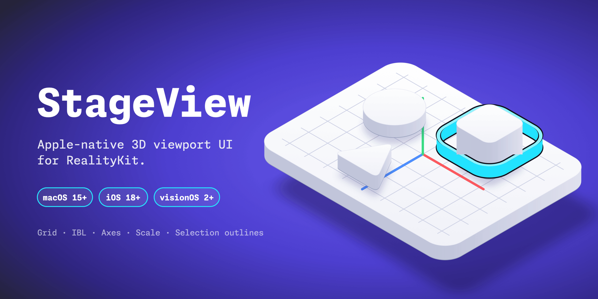

A RealityKit viewport for SwiftUI apps: orbit camera, scale-aware grid, colored axes, image-based lighting, overlays, picking and selection highlighting, on macOS, iOS and visionOS.

## Install

```swift
.package(url: "https://github.com/Reality2713/StageView.git", from: "0.4.0")
```

Products: `RealityKitStageView` (the viewport) and `StageViewOverlay` (SwiftUI overlays with no RealityKit dependency).

## Quick start

```swift
import ComposableArchitecture
import RealityKitStageView

let provider = RealityKitProvider()
let store = Store(initialState: StageViewFeature.State()) { StageViewFeature() }

RealityKitStageView(provider: provider, store: store)
    .task {
        store.send(.loadRequested(commandID: UUID(), url: modelURL, preserveCamera: false))
    }
```

## Features

- **Grid and axes:** scale-aware grid (1 m is always 1 m, `metersPerUnit`, Z-up) with X/Y/Z axes.
- **Lighting:** IBL from an environment map with EV-style exposure, rotation and blur.
- **Overlays:** orientation gizmo and an auto-switching scale indicator (cm/m/km), plus custom overlay items.
- **Selection:** bounding box, mesh outline, or a pixel-exact post-process outline ([SelectionEffects](https://github.com/elkraneo/SelectionEffects), iOS/macOS 26+).
- **Picking:** imported entities map back to prim paths, with hooks to remap coarse importer nodes.
- **Hosting:** render your own entity hierarchy, receive scene-space drag samples, capture the viewport as an image, control embedded animation playback.

## Configuration

```swift
var configuration = RealityKitConfiguration()
configuration.environmentMapURL = hdrURL          // IBL
configuration.environmentExposure = 0             // EV, 0 = neutral
configuration.selectionHighlightStyle = .boundingBox
configuration.appearance = .dark                  // themes background and grid
```

Pass it as `RealityKitStageView(provider:store:configuration:)`.

## Picking imported content

`Entity(contentsOf:)` can collapse an import into generic nodes such as `merged_1`. Remap them to the prims you want selected:

```swift
provider.setPickPathOverrides(["/RootNode/merged_1": "/RootNode/Forklift"])
provider.setPickPathResolver { directPath, entity, provider in
    directPath == "/RootNode/merged_1" ? "/RootNode/Forklift/Body" : nil
}
```

Overrides win, then the built-in generic-node fallback, then the direct mapping. Details: [RealityKit Prim-Entity Mapping](resources/REALITYKIT_PRIM_ENTITY_MAPPING.md).

## Hosting your own entities

```swift
provider.setModel(rootNode: myEntity, metersPerUnit: 1, isZUp: false)
configuration.source = .injectedEntity       // picking works without a model URL

configuration.interactionMode = .entityDrag  // drags on the selection report scene-space samples
provider.setEntityDragHandler { sample in hostRuntime.apply(delta: sample.delta) }
```

The viewport never moves an entity itself: your runtime applies the drag. Bounds are derived from the entity unless you call `setExternalSceneBounds(_:)`.

## Requirements

macOS 15+, iOS 18+, visionOS 2+, Swift 6. The post-process outline needs iOS/macOS 26 and falls back to the mesh outline on earlier versions.

## Related

- [SelectionEffects](https://github.com/elkraneo/SelectionEffects): the post-process selection outline and frame capture

## License

This project is available under the MIT license.
See the LICENSE file for more info.
